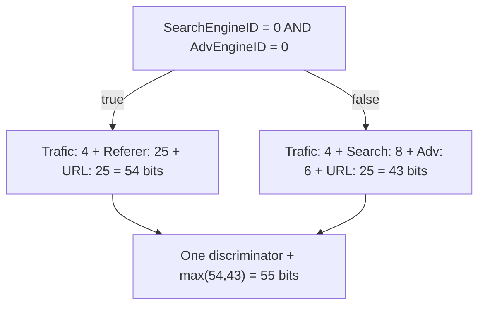

# Experiment 34: conditional layouts for exact composite keys

Keep the original branch-specific layout. Q40's ordinary packed tuple
needs 68 bits: TraficSourceID 4, SearchEngineID 8, AdvEngineID 6,
Referer 25, and URL 25. Reserving all fields simultaneously cannot fit
the existing 64-bit identity word.

The CASE expression reveals that these fields do not all vary together.
When SearchEngineID=0 and AdvEngineID=0, those explicit group keys are
fixed and Src is Referer. Otherwise Src is the constant empty string.

Build an exact layout for each branch, omit only fields proved constant
there, and place a discriminator above both layouts. The resulting word
is an identity; ordinary hash mixing still determines table placement.

## Required correctness condition

Every equality-guard column must also be an explicit independent group key.
That proves the branch tuple domains are disjoint. Without this condition,
two rows could have equal output keys despite taking different branches,
and a discriminator would incorrectly split one group.

The implementation recognizes conjunctions of numeric column-to-constant
equalities and a string CASE between a column and a literal. Other shapes
retain existing packing or logical comparison. Both branch layouts must
fit within 63 bits before adding the discriminator.

Tests force an otherwise oversized tuple, verify cross-stripe exact results,
and include a missing-guard case that must fall back and coalesce equal keys.
All alternative layouts and frames are charged to the query budget.

## Full-data result

Engine da05fe6, original Q40, full data, eight threads, minimum client
milliseconds of trials two and three:

- PGAccel conditional layout and bounded reservation: 44.706 ms.
- Fresh checkpoint 2 ClickHouse: 118.877 ms.
- Prior full indexed PGAccel: 186.773 ms.

All 21 subset answers validate. The 83-test native suite passes.
The result includes the simultaneous input-reservation improvement;
the two effects are not separately isolated for Q40.

Evidence: conditional-reserve.jsonl, its metadata and gate.
Frozen binary: ../clickbench-work/research-20260905/bin/conditional-reserve-query-runner.
No new persistent index, query cache, or external dependency is introduced.
