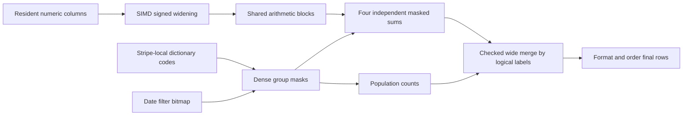

# CPU execution changes

## Q1: dense grouped arithmetic

Q1 is an aggregation, not a join. The former path constructed composite
keys and recursively interpreted each aggregate's expression for every
selected row. The retained path uses the same original SQL and native
columns, but chooses an execution kernel from their expression and
storage properties.

The kernel accepts one or two direct dictionary group columns whose
cardinality product is at most 16. A pair of codes `(a,b)` has local ID
`a * second_dictionary_size + b`. These IDs are local to a stripe. The
final merge compares actual typed labels, so a different dictionary code
for the same string or date in another stripe cannot split a SQL group.

For each stripe, a small expression program deduplicates common inputs
and subexpressions. SUM and AVG can consume the same root sum; AVG uses
that sum and the matching row count. Blocks contain 256 rows. Numeric
inputs of widths 1, 2, 4, and 8 bytes are widened with signed SIMD loads.
Constant decimal scaling is folded before the arithmetic loop.

For example, a price of 100.00, discount 0.05, and tax 0.07 have stored
integers 10000, 5, and 7. The discounted-price expression produces 950000
at scale 4 (95.00), and the charge expression produces 101650000 at scale
6 (101.65). The execution never substitutes floating point for these
fixed-scale products and sums.

Every arithmetic node is bounded from stripe statistics. The fast path
requires each intermediate and each stripe root sum to fit signed 64
bits. A failed proof falls back to checked 128-bit execution. Final
merges use checked 128-bit addition. Negative operands and cancellation
remain exact; the proof bounds subsets as well as the complete stripe.

Repeated group IDs make a naive gather/add/scatter accumulator unsafe:
several SIMD lanes could read the same old total and overwrite each
other's updates. This kernel instead masks each group's input values and
reduces independent lanes. Four accumulators reduce loop overhead and
instruction dependencies. Population counts of the same selection masks
provide exact group counts, including partially filled final blocks.

All expression compilation, scans, filters, temporary arrays, grouping,
merging, formatting, and ordering remain inside query time. No result or
aggregate cache is retained between statements. The native storage and
load protocol are unchanged. Scratch space and persistent group state
are charged to the query budget.

Experiments and full trial sequences are in [RESULTS.md](RESULTS.md).
Two mask-sharing layouts and an explicit multiply-width specialization
were rejected because they were slower. CPU samples, rather than a
presumed SIMD benefit, identified dictionary metadata calls and scalar
numeric decoding as substantial costs.

## Next: validated positional joins

The first join experiment will verify consecutive build keys using SIMD.
Only a complete proof permits mapping a key to a row position by
subtraction and stripe arithmetic. This can eliminate a hash directory
and its allocation for suitable layouts. Min/max and row count alone do
not establish a sequence: duplicates, permutations, missing keys, and
filters require exact fallback. This experiment is not yet benchmarked
or retained; [PLAN.md](PLAN.md) records the research and subsequent work.
