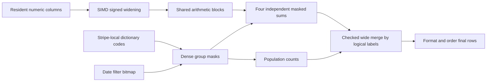
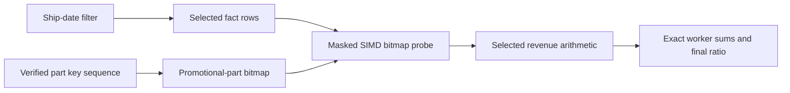

# CPU execution changes

## Q1: dense grouped arithmetic

Q1 is an aggregation, not a join. The former path constructed composite
keys and recursively interpreted each aggregate's expression for every
selected row. The retained path uses the same original SQL and native
columns, but chooses an execution kernel from their expression and
storage properties.



The kernel accepts one or two direct dictionary group columns whose
cardinality product is at most 16. A pair of codes `(a,b)` has local ID
`a * second_dictionary_size + b`. These IDs are local to a stripe. The
final merge compares actual typed labels, so a different dictionary code
for the same string or date in another stripe cannot split a SQL group.

For each stripe, a small expression program deduplicates common inputs
and subexpressions. SUM and AVG can consume the same root sum; AVG uses
that sum and the matching row count. Blocks contain 256 rows. Numeric
inputs of widths 1, 2, 4, and 8 bytes are widened with signed SIMD loads.
Constant decimal scaling is folded before the arithmetic loop.

For example, a price of 100.00, discount 0.05, and tax 0.07 have stored
integers 10000, 5, and 7. The discounted-price expression produces 950000
at scale 4 (95.00), and the charge expression produces 101650000 at scale
6 (101.65). The execution never substitutes floating point for these
fixed-scale products and sums.

Every arithmetic node is bounded from stripe statistics. The fast path
requires each intermediate and each stripe root sum to fit signed 64
bits. A failed proof falls back to checked 128-bit execution. Final
merges use checked 128-bit addition. Negative operands and cancellation
remain exact; the proof bounds subsets as well as the complete stripe.

Repeated group IDs make a naive gather/add/scatter accumulator unsafe:
several SIMD lanes could read the same old total and overwrite each
other's updates. This kernel instead masks each group's input values and
reduces independent lanes. Four accumulators reduce loop overhead and
instruction dependencies. Population counts of the same selection masks
provide exact group counts, including partially filled final blocks.

All expression compilation, scans, filters, temporary arrays, grouping,
merging, formatting, and ordering remain inside query time. No result or
aggregate cache is retained between statements. The native storage and
load protocol are unchanged. Scratch space and persistent group state
are charged to the query budget.

Experiments and full trial sequences are in [RESULTS.md](RESULTS.md).
Two mask-sharing layouts and an explicit multiply-width specialization
were rejected because they were slower. CPU samples, rather than a
presumed SIMD benefit, identified dictionary metadata calls and scalar
numeric decoding as substantial costs.

## Validated positional joins

The retained sequence index verifies every build key with SIMD. Within
one stripe, keys must be consecutive; the index then sorts stripe ranges
and proves a consecutive logical domain. Native stripes can arrive in
completion order, so a small logical-to-physical stripe directory is
essential. Min/max and row count alone never establish uniqueness.

A matching key becomes an offset by subtraction, then a physical row ID
through the stripe directory. Duplicate, missing, or irregular keys use
the general join implementation. The generic join planner can choose the
validated positional side without allocating a per-row hash table.

## Q14: filter, bitmap probe, and arithmetic in one pipeline

Q14 joins lineitem to part, filters a shipping month, and computes the
promotional revenue fraction. Positional lookup alone reduced SF10 time
from about 1.29 seconds to 0.58 seconds. The larger improvement came from
fusing the operators and avoiding materialized joined rows.

The kernel proves the full build key sequence, then evaluates the build
string predicate once per dictionary label. It creates an exact bitmap
in logical key order: one bit records whether each part is promotional.
Native date filtering first selects fact rows. Masked AVX-512 gathers
probe the bitmap, and selected-row arithmetic computes revenue directly.
The query builds this bitmap anew on every execution.



A false CASE condition contributes zero, but still contributes a nonnull
row to SUM's count. Numeric range proofs and checked wide final merging
preserve decimal semantics. Unsupported predicates, key layouts, or
arithmetic use the general executor. The SF100 result and Q1 recheck are
in [Q14-SF100.md](Q14-SF100.md).

## Q3: exact sparse membership with compact group ranks

Q3 filters customers, joins qualifying orders, then sums revenue from
qualifying lineitems by order. The retained three-table kernel requires
a chain of two equality joins and a grouped identity containing the
bridge join key. It proves uniqueness of the selected bridge keys. Other
bridge grouping fields are then functionally determined; no composite
hash key is necessary. Duplicate selected bridge keys fall back.

A verified customer sequence provides a compact segment-membership
bitmap. Workers filter orders and probe this bitmap, collecting selected
order keys and physical row IDs. Order keys can be sparse: their bitmap
is indexed by the exact integer offset, with a prefix population count
per 64-bit word. A key's compact group rank is:

```
rank = prefix[word] + popcount(word_bits & (key_bit - 1))
```

For example, keys 3, 8, and 20 occupy just three payload and aggregate
slots even though their bitmap spans a larger integer domain. The rank
is collision-free. The executor caps domain expansion and falls back for
unsuitable sparse domains instead of allocating an unbounded directory.

Workers atomically set bitmap bits, detecting duplicates even across
workers, then scatter physical bridge row IDs into unique rank slots.
Fact rows pass their native date filter and an AVX-512 membership probe
before numeric arithmetic. Compact group sums use exact atomic addition;
a visited bitmap preserves groups whose final sum is zero. Repeated keys
within SIMD lanes or across workers cannot overwrite one another.

This path needs a stronger numeric proof than independent stripe sums:
each stripe's extrema multiplied by the total fact row count must fit
signed 64 bits, bounding every possible concurrent partial group. Wider
cases fall back. Final ordering and LIMIT still run through QueryResults.
Every bitmap, rank payload, and aggregate allocation is budgeted, and no
query result or prepared join directory survives the statement.

The research references and license policy are in [PLAN.md](PLAN.md).
These are original implementations, with no imported research code.
