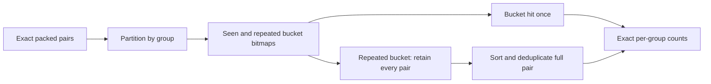

# Q16: compact exact join and distinct counting

Status: implementation `e2cfc7f` under validation; no performance promotion yet.

Q16 groups filtered parts by brand, type, and size, joins partsupp, and
counts distinct suppliers after excluding a supplier subquery. The general
executor carries string group keys and per-group distinct state through
this join. The new path separates dimension selection, join lookup, and
exact pair deduplication.

1. Prove the dimension key is unique and consecutive from its actual raw
   values. A small stripe directory handles physical publication order.
   Duplicate or gapped keys use general execution.
2. Intern string dictionary labels across stripes into exact query-local
   identities. Local dictionary codes alone are not global identities.
   Normalize small numeric domains and pack at most four group columns
   into at most 24 bits. Larger domains use general execution.
3. Evaluate dimension predicates with native bitmap filters, including
   NOT LIKE and disjunctions. Store a four-byte group identity per selected
   dimension row and retain one original row for output projection.
4. Execute the membership child under the remaining parent budget. Build
   an exact bitmap or hash membership set from its numeric output.
5. Scan facts and look up their dimension group using the proved key
   sequence. Normalize the counted integer domain only when its full
   range fits 32 bits. Pack the exact group and counted value into one
   64-bit word. Missing dimension rows and excluded suppliers produce no
   pair; duplicate fact rows remain until exact deduplication.
6. Partition by group identity, sort each independent partition, and count
   changes in the entire packed word. All pairs for a group belong to one
   partition, so workers update disjoint counts. Release input buffers as
   they are scattered. Project original labels and apply normal ordering,
   offset, and limit.

Both mappings and all temporary buffers are built during every query;
there is no cached answer or persistent join index. Allocations use the
query budget, child peak memory and spills are accounted, and unsupported
shapes retain the general executor. Numeric raw columns have no nulls in
this engine's supported storage model.

The independent-partition idea is consistent with DuckDB's description of
[external aggregation](https://duckdb.org/2024/03/29/external-aggregation).
This implementation uses original exact packed-pair sorting code; no
third-party implementation or runtime dependency was added.

Validation before benchmarks: 206 native tests pass, including duplicate
fact and dimension keys, cross-stripe dictionary identities, positive and
negative membership, empty exclusions, signed integer endpoints, wide
fallback, result slicing, and strict child budgets. Six focused AddressSanitizer/UndefinedBehaviorSanitizer tests also pass.
All 22 SF1 answers match DuckDB at `e2cfc7f`. Benchmark promotion requires fresh
15-trial SF10 and 9-trial SF100 runs against both peers; warm medians omit
only trial one and every answer must match.

## Follow-up experiments

The compact-output path (`cd9a536`) orders exact lexical component ordinals
before formatting rows. Its isolated SF10 warm median is 100.739 ms,
compared with 120.637 ms for the first packed-pair implementation. This is
not a fourfold peer win. Raw trials are retained in the iteration report.

Next, test bounded radix passes within independent pair partitions and
normalize multi-column result order into fixed integer sort keys. DuckDB's
[2025 sort redesign](https://duckdb.org/2025/09/24/sorting-again) explains how
normalized keys and static integer comparisons reduce interpreted tuple
comparison overhead. Our compact dictionary domains permit exact ordinal
keys without storing string prefixes or truncating comparisons. Implement
and measure these changes independently before retaining performance claims.

## Narrow probes and output materialization

The first gather implementation widens input blocks and probes eight
64-bit keys. A later path proves both key domains fit signed 32-bit bounds,
then probes sixteen rows directly from raw storage, skipping supplier
loads when the dimension mask is empty. It preserves masked tails and
falls back to wide keys or scalar sparse memberships as needed.

Output rows are independent after ordering. The executor reserves their
storage and charges a conservative per-row string bound before formatting
disjoint ranges in parallel. This removes serial formatting and avoids
per-cell budget atomics between workers. The isolated SF10 client median
is 62.943 ms at `a57b51c`, still short of the fourfold peer requirement.

The benchmark runner now buffers the identical JSON rows before writing
them. Escaping, complete answers, and client timing boundaries are unchanged.
This is a response serialization improvement, separate from engine runtime;
its additional response buffer is reflected in process memory, not the
executor's temporary allocation counter. Final comparisons use one frozen
runner at both scales and retain all answer conversions in client timing.

## Exact bitmap filtering of duplicate candidates

After partitioning exact `(group, supplier)` pairs, hash each pair into a
bounded bitmap. Record both seen buckets and buckets hit more than once.
A second pass counts pairs in singly hit buckets immediately and sends all
pairs from repeated buckets to exact sorting. This cannot miss a duplicate:
identical pairs always choose the same bucket, and every copy is retained
when that bucket repeats. Different pairs colliding in a bucket merely
increase exact-sort work. No approximate count is returned.

Bitmaps use at most 256 KiB per worker and are rebuilt for every partition.
The first isolated SF10 measurement is 52.914 ms at `c8281ac`, compared
with 54.615 ms for the separate ordering helper. The earlier local hash
experiment was rejected: 66.242 ms versus its 62.943 ms baseline. All
experiments and their raw trials remain available in the iteration report.

The next scheduling experiment addresses false sharing: interleaved
partitions let workers repeatedly write different counters in the same
64-byte cache line. Partition ranges can instead end on the actual counter
array's cache-line boundaries. Because the partition bits are the low group
bits, the same boundary applies to every higher group component. This
changes worker ownership while preserving the exact partition assignment.

## Subsequent checks and the repeated-key experiment

The first fresh confirmation remains short of the DuckDB target. Compact
integer IN filters, equality-OR folding, private partition counters, verified
identical dictionaries, and vectorized JSON escaping were then measured.
The second fresh 15-trial comparison still yields about 53.6 ms client time,
so none of these iteration figures is a promotion. See the confirmation
report for every peer time and trial. All 22 SF1 answers match at `1b05f3d`.

The next join experiment infers a power-of-two foreign-key fanout of at
most sixteen from actual row counts. It verifies every stored key against
the repeated sequence, then checks sorted stripe ranges for complete,
non-overlapping coverage of the dimension key domain. A small query-local
stripe directory can then locate the supplier run for a selected part.
The runtime must retain its gather path when any proof fails. The fanout
is inferred and checked; the TPC-H value of four is not hard-coded. The
full proof is timed during each query and no persisted index is introduced.
