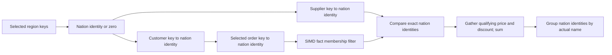

# Q5: converging dimension identities

Status: initial executor passes focused regression tests; performance has not
been measured yet. The SF10 baseline native call is 11,467.3 ms, versus 183.9 ms
DuckDB and 590.5 ms ClickHouse (nine trials, first excluded from medians).

Q5 needs matching customer and supplier nations, selected region and order
dates, and an exact sum of discounted prices grouped by nation name. The
current general join executor materializes join state before aggregation.

The proposed limited fast path propagates a compact identity through two
foreign-key chains. It does not retain joined rows for each lineitem.

1. Form equivalence classes from column equalities. The original predicates
   `c_nationkey = s_nationkey` and `s_nationkey = n_nationkey` imply one class.
2. Prove a unique target key in each class using consecutive or disjoint sorted
   stripe checks. Statistics alone do not establish uniqueness. Retain only a
   small stripe directory for the proof, constructed inside every query.
3. Require two disjoint chains from the fact table that first meet at the
   grouped dimension. A common chain beyond that dimension can apply filters.
   Earlier convergence, cycles, additional constraints, unsupported key types,
   duplicate target keys, and arbitrary many-to-many joins keep the fallback.
4. Build filtered dimension payloads from the smallest dependencies outward.
   Consecutive keys use 32-bit dense payload arrays. Sparse sorted keys use an
   exact membership bitmap and rank directory, retaining payloads only for
   selected keys. A zero payload means no qualifying dimension row.
5. Carry the grouped dimension's **row identity**, not its display label.
   Different nations can have equal names. Compare row identities before
   grouping names, so duplicate labels cannot silently relax the join.
6. Start the fact scan with the more selective arm's membership bitmap. Use
   bounded 16-lane AVX-512 probes for 32-bit keys, scalar handling otherwise.
   Only survivors fetch the other key, compare identities, and gather revenue
   inputs. Per-worker exact 128-bit sums avoid shared aggregate writes.
7. Merge identities by the actual group value and use the existing result
   formatter for order, offset, and limit semantics.

The first implementation supports one direct dimension grouping expression and
one fact-local SUM expression. It retains the checked arithmetic program and
falls back for unsupported representations. All payloads and bitmap directories
are query-local and charged to the query budget. There is no result cache or
optional persisted index. The grouped center is bounded to 65,536 rows; sparse
key domains must be at most eight times their row count and at most 2^32 wide.

## Evaluation stages

- Compare direct execution with the general relational executor on duplicate
  labels, missing keys, shuffled sparse stripes, filters, tails, empty results,
  slices, signed keys, duplicate-key fallback, and allocation limits.
- Run native and sanitizer checks, then all22 SF1 answer validation.
- Run nine SF10 iteration trials against the saved baseline oracle.
- Keep useful changes in small commits and document unsuccessful experiments.
- Require a fresh 15-trial SF10 gate against both peers before a same-module
  nine-trial SF100 comparison with the existing process limits.

## Research and licensing

The design is an original combination of exact integer membership, query-local
key proofs, filter propagation, and fused aggregation. No third-party join
implementation is copied. Research informs the choice of what to measure:

- [Balkesen et al., main-memory hash joins](https://dbis.cs.tu-dortmund.de/publikationen/2013/main-memory-hash-joins/)
  studies tuning CPU joins to hardware; SIMD alone is not a universal algorithm
  choice. Here, the narrower data model lets us avoid most general hash probes.
- [DuckDB parallel grouped aggregation](https://duckdb.org/2022/03/07/aggregate-hashtable)
  explains parallel aggregate state. Q5's tiny result domain makes private
  arrays worth measuring before considering shared hash-table updates.

The research sources are references, not dependencies or copied code.
