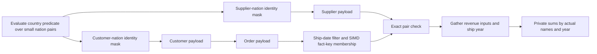

# Q7: two dimension identities and a date group

Status: the first executor passes ten focused native checks. Full native and
sanitizer checks are in progress; no optimized timing is claimed yet.

The fresh nine-trial SF10 baseline is 10,190.2 ms for native PGAccel, 177.4 ms
for DuckDB, and 580.4 ms for ClickHouse. Warm medians exclude only trial one.
The approximate iteration target against DuckDB is 44.3 ms.

## Query shape and retained semantics

Q7 joins each lineitem to its supplier nation and to its customer nation through
orders. It keeps the France/Germany pairs in either direction, restricts ship
dates, and groups discounted revenue by both nation names and ship year.

The parser already inlines this query's projection subquery. A draft executor
rewrite was discarded after inspection and a failed applicability assertion
confirmed that there is no materialized projection boundary here. No redundant
projection rewrite was committed or included in a measured module.

- Prove unique target keys and two disjoint foreign-key chains. The terminal
  dimensions may be aliases of the same physical table; their logical identities
  remain distinct. Additional equalities or shared chain nodes retain fallback.
- Evaluate the remaining coupled predicate over terminal row pairs. At most 256
  rows per terminal are supported, so the predicate table has at most 65,536
  entries. Remove terminal identities that participate in no valid pair before
  propagating their payloads through either chain.
- Carry exact row identities through joins. Duplicate labels are grouped only
  through value-based dictionary keys; they do not collapse intermediate joins.
- Reuse query-local dense or sparse identity payloads from Q5. Consecutive keys
  use one-, two-, or four-byte arrays; gapped keys use bitmap/rank directories.
- Scan fact dates and probe the more selective arm first. Only survivors fetch
  the other key, check the pair table, extract the ship year, and gather revenue
  inputs. Each worker owns exact 128-bit aggregate states.
- Preserve output ordering, aliases, limits, and offsets through the existing
  result formatter. Unsupported shapes retain the relational executor.

When the parser sees the country OR expression, other simple WHERE predicates
may remain expression nodes too. The first test run caught this applicability
case. The executor lowers exact local literal predicates into native filters
before splitting join equalities from coupled terminal predicates.

The limited implementation accepts one fact-local SUM, two direct terminal
columns, and one EXTRACT(year FROM a fact DATE) group. Calendar domains are
bounded to 64 years and at most 65,536 combined output slots. All tables,
key proofs, pair predicates, and group values are checked afresh for each query.

## Staged evaluation

1. Compare directly with the general relational executor across aliases,
   duplicate labels, dates before and after the epoch, filters, empty answers,
   missing keys, tails, slices, and duplicate-key fallback.
2. Run full native and focused sanitizer checks, then all22 SF1 answers.
3. Measure nine SF10 trials and profile remaining costs. In particular, Q7
   scans more orders than Q5 because it has no order-date predicate.
4. If payload construction dominates, test SIMD propagation from narrow dense
   arrays. Measure the benefit before adding more key-layout specialization.
5. Require fresh 15-trial SF10 and same-module nine-trial SF100 confirmations
   against both peers, preserving all trials and the existing memory caps.

This is original code reusing this project's permissive implementations. The
CPU join and parallel aggregation references in [Q5-DESIGN.md](Q5-DESIGN.md)
remain relevant; no third-party join code or new dependency is introduced.
